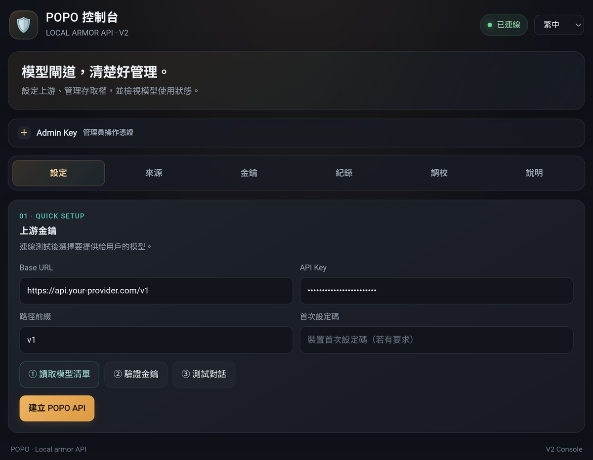
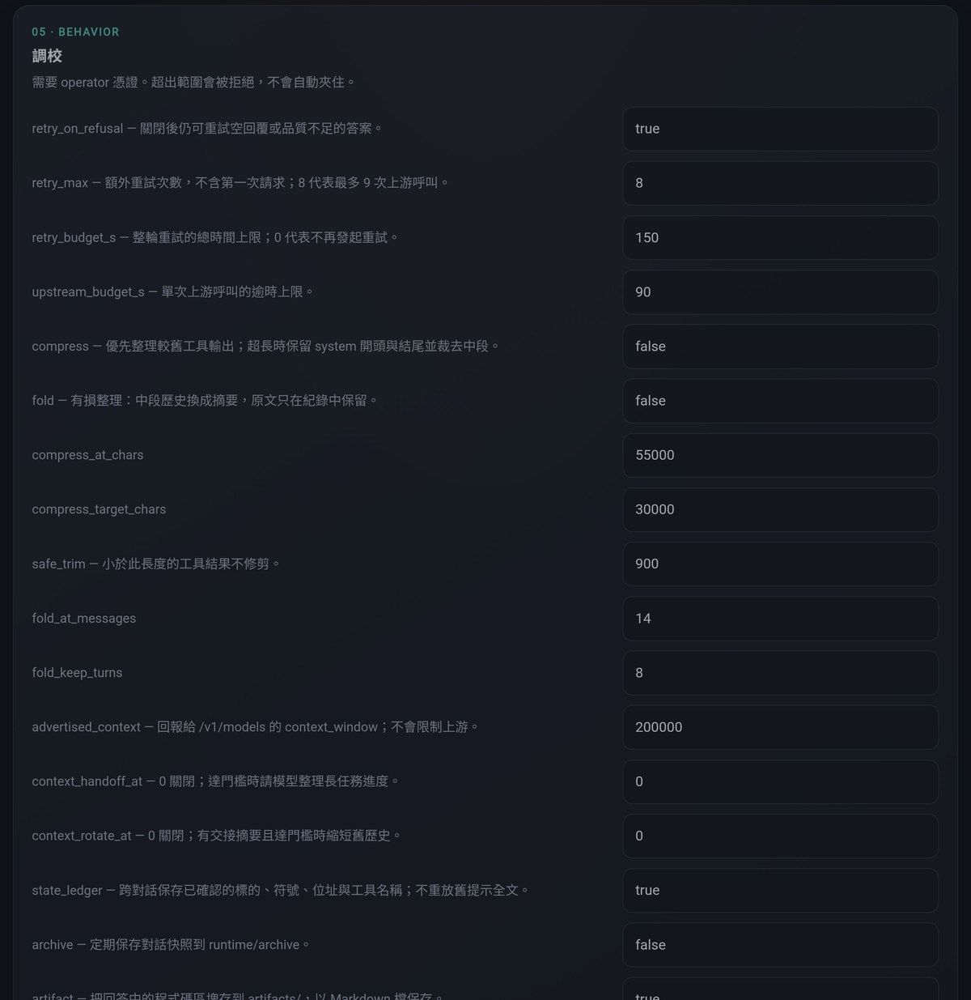
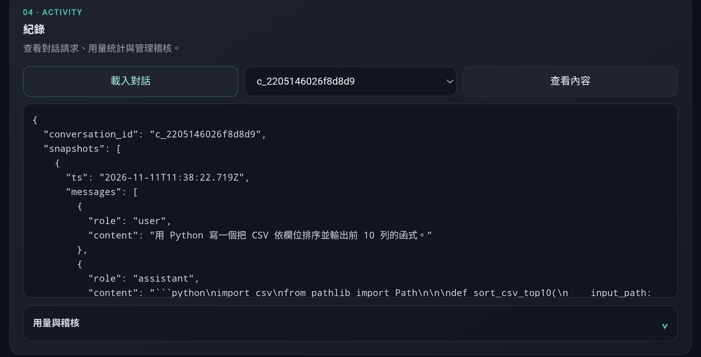

[繁體中文](README.md) · **English**

<div align="center">


<br>

**Give it an upstream API. Get back your own.**

Python standard library · OpenAI-compatible · Anthropic Messages translation · multi-source routing · optional prompt blocks · bilingual console

<br>


</div>

---

> ### ⚠️ Disclaimer — read this first
>
> This project is intended for **lawful use only**: security research, penetration
> testing **with authorisation**, CTF, technical questions about systems you own,
> and personal study or development work.
>
> **Prohibited**: breaking into systems you do not own, exfiltrating data,
> writing or distributing malware, circumventing another service's payment
> mechanism, or anything that violates applicable law or a service's terms.
>
> You are solely responsible for what you do with it. The author accepts no
> liability for misuse, data loss, legal consequences, or third-party claims.
> The software is provided **as is**, without warranty of any kind.
>
> Full terms: [LICENSE](LICENSE) (CC BY-NC 4.0) and [SECURITY.md](SECURITY.md).

---

## What this version is

POPO is a **model API gateway**. Give it a set of upstream credentials (base URL
and key) and it starts **its own OpenAI-compatible API** on your machine, wrapping
the upstream with a unified model namespace, optional prompt blocks, bounded
refusal retries, context management, per-turn records, and live tuning.

```
your client  ──►  POPO (127.0.0.1:8412)  ──►  your upstream provider
 (any OpenAI      · routing and aliases        (OpenAI / OpenRouter /
  client, SDK,    · prompt block injection       Groq / Ollama / self-hosted)
  curl, Claude    · refusal retry, history
   Code)            scrub
                  · records, audit, replay
```

**Change models without touching your client. Change clients without repasting
the prompt. Change devices by pointing at the same URL.**

The core service is **standard library only** (`http.server`, `ssl`, `json`) —
there is no `pip install` step. The console is plain HTML/JS with no build
pipeline and no external CDN.

---

## Quick start

Requires **Python 3.10+**. No third-party packages for the core service.

```sh
python3 -m popo.server.app
```

```powershell
# Windows
py -3.10 -m popo.server.app
```

Open **http://127.0.0.1:8412/app/**

### First-run setup (four steps)

| Step | What you do | Image |
|---|---|---|
| **1 · Upstream API** | Enter the base URL (ending in `/v1`) and API key → "load model list" | ↓ |
| **2 · Models and blocks** | Tick the models to publish, pick the prompt block set for each | ↓ |
| **3 · Public or local** | Choose local if only you will use it (loopback, no key needed) | ↓ |
| **4 · Apply** | Get a **Base URL** and one `triad-…` client key | ↓ |



The generated client key is **shown once** — copy it immediately. Then any client:

```
Base URL : http://127.0.0.1:8412/v1
API Key  : triad-…
Model    : glm-5.3        (one of the models you ticked)
```

---

## What it solves

| Pain | Without it | With it |
|---|---|---|
| The prompt block is 30k+ chars | paste it into every client until context dies | injected per request, per model family |
| One refusal kills the whole thread | start a new conversation | bounded retries, each reframed |
| The client is blocked by CORS | web clients unusable | the proxy is same-origin to your client |
| "What did it actually receive?" | guess | diagnostic headers + console preview |
| Context window fills up | trim by hand | compression and folding, separately controlled |
| Several clients each need the prompt | maintenance nightmare | all point at one URL |
| Shared host, don't want transcripts on disk | logs everywhere | ephemeral mode, nothing written |

---

## Prompt blocks (optional)

`blocks/` is plain text; `blocks/registry.json` decides **which block goes to
which model**. There is not a single prompt sentence in the code — you can swap
the whole set for your own without touching Python.

| Block | Contents |
|---|---|
| `00_contract.txt` | Delivery contract: short, structured, works on any model |
| `10_cinder_nodebt.txt` | Persona (no thinking-budget clause, no forced signature) |
| `10_persona.txt` | Original persona (with the thinking-budget clause) |
| `15_glm_53_delivery.txt` | GLM-5.3 output format and tool-argument calibration |
| `16_deepseek_v41_delivery.txt` | DeepSeek V4.1 Flash structured-output calibration |
| `20_prefill.txt` | Assistant prefill fragment |
| `30_gpt_guard.txt` | Guard clause for the GPT family |

**"No injection" (profile `off`) is always available.** The generic
`native_contract` profile is a fallback, not a tuned one. Edits take effect on the
next request — no rebuild, no restart.

---

## Tuning

The console **"Tuning" page** exposes four groups. Every field states what it
actually changes, because names like `compress` and `fold` silently alter answers
once switched on.



### Retry and scoring

| Field | Default | Meaning |
|---|---|---|
| `retry_on_refusal` | on | Reframe and re-ask when an answer is a refusal |
| `retry_max` | 8 | Extra retries **after** the first call → at most 9 upstream calls |
| `retry_budget_s` | 150 | Wall-clock ceiling for all retries in one round |
| `upstream_budget_s` | 90 | Timeout for a single upstream call |

### Context management

| Field | Default | Meaning |
|---|---|---|
| `compress` | off | **Least loss**: trim tool output, keep the head and tail of the system message, cut the middle |
| `fold` | off | **Lossy**: replace the middle of the history with a summary; original text survives only in records |
| `compress_at_chars` / `compress_target_chars` | 55000 / 30000 | When to start, how small to get |
| `safe_trim` | 900 | Tool results shorter than this are never trimmed |
| `fold_at_messages` / `fold_keep_turns` | 14 / 8 | When folding starts, how many trailing turns stay verbatim |
| `advertised_context` | 200000 | `context_window` reported by `/v1/models`; **does not cap the upstream** |
| `context_handoff_at` | 0 (off) | At this threshold, ask the model for a long-task handoff document |
| `context_rotate_at` | 0 (off) | With a handoff present and the threshold hit, shorten the history |

> **Compression vs folding**: compression *trims* (text remains); folding
> *summarises* (text is gone). For precise work, enable compression only.

### State and records

`state_ledger` (on) remembers confirmed targets, offsets, symbols, addresses and
tool names across turns without replaying the whole prompt; `archive` (off)
periodically snapshots conversations to `runtime/archive`; `artifact` (on) writes
code blocks from answers to disk.

### Records and access

`scrub_refusals` (on) drops refusal turns from history; `scrub_prose` (off — the
default is off for a measured reason: keeping planning narration gives the model
its own prior decisions back); `capture_responses` / `capture_full` (off);
`require_client_key` (on — turning it off opens the proxy).

**Out-of-range values are rejected, never clamped** — clamping hides a typo.
Fields that need a restart say so and are refused individually; a batch applies
only if every field validates. Settings persist to `proxy/panel_settings.json`
(0600) and do not silently revert on restart.

---

## Records and audit

The console **"Records" page** loads conversations, shows per-turn snapshots,
compares models, and replays existing requests.



The shape is **client → conversation → turn**: expand a turn to see every attempt
(including abandoned ones) and the full answer. Usage statistics and an
administrative audit live alongside, with retention-based cleanup that refuses to
silently delete unparsable data.

---

## Features

| Feature | Detail |
|---|---|
| **OpenAI Chat Completions** | Standard `/v1/chat/completions` including real streaming (sub-second TTFB) |
| **Anthropic Messages** | Full SSE lifecycle for `/v1/messages`: `message_start`, content-block start/stop, text and tool deltas, `message_delta`, `message_stop`. `tool_use` / `tool_result` round-trip correctly; image URLs and base64 images are converted |
| **Pass-through endpoints** | `/v1/images/generations`, `/v1/embeddings`, `/v1/audio/transcriptions` forwarded as-is, no injection |
| **Multiple sources** | Different models on different providers, each with its own key. Secrets and routing are stored separately |
| **Aliases and publishing** | Only published models are routed; short aliases (`glm`, `deepseek`) resolve to real IDs; **publishing never deletes bare aliases** |
| **Refusal handling** | Classifier + bounded retry + quality scoring. `truncated` is a distinct state from `refused` (a budget-exhausted empty answer is not retried and not passed off as complete) |
| **Context** | Compression, folding, long-task handoff, post-summary rotation — four independent switches |
| **Identity** | Client keys (SHA-256, shown once), admin accounts (PBKDF2), persisted sessions, four-layer gate, login rate limiting |
| **Security boundaries** | Local same-origin admin requires peer, Host, Origin, `Sec-Fetch-Site` **and** absence of forwarding headers. Tunnel traffic never gets the no-login admin identity. Setup probes enforce an egress allow-list (rejecting loopback, private, link-local, metadata) that re-checks **every** resolved address, and authorisation happens **before** any socket work |
| **Concurrency** | Bounded semaphore, bounded wait (429 on timeout rather than an unbounded queue), slot released in `finally` |
| **Diagnostics** | `X-Armor-Request-Model`, `X-Armor-Upstream-Model`, `X-Armor-Policy-Len`, `X-Armor-Retries`, `X-Armor-Verdict` |
| **Console** | Six pages (setup / sources / keys / records / tuning / about), zh-Hant and English, installable as a PWA, zero build |
| **Ephemeral mode** | `POPO_EPHEMERAL=1` writes nothing. The upstream key is still **read** — it is input, not a record |

---

## Diagnostics: what did it actually do

Every response carries:

```
X-Armor-Request-Model   glm
X-Armor-Upstream-Model  glm-5.3
X-Armor-Policy-Len      34059      ← characters injected this call (0 = nothing)
X-Armor-Retries         2          ← how many retries were spent
X-Armor-Verdict         retry_ok   ← the retry recovered it
```

To see the exact text the model would receive, without sending a request:

```sh
curl "http://127.0.0.1:8412/armor?model=glm-5.3&level=native"
```

The reply is the real payload, not an approximation. Per-request override is
`X-Armor-Level`; values outside the allow-list return 400 rather than being
silently ignored.

---

## Deployment

| Layout | Exposure | On-disk records | Good for |
|---|---|---|---|
| Local | loopback only | yes | development, personal use |
| SSH tunnel | loopback only | either | VPS, safest |
| **ephemeral** | tunnel or LAN | **none** | shared hosts |
| LAN | `0.0.0.0` | yes | phone and tablet on your own network |

Common environment variables (the full list lives in `popo/config.py`, `ENV_ALIASES`):

```sh
POPO_BIND=127.0.0.1        # listen address
POPO_PORT=8412             # port
POPO_REQUIRE_KEY=1         # require a client key when exposed
POPO_EPHEMERAL=1           # write nothing to disk
POPO_ARMOR=1               # enable prompt blocks
POPO_MAX_CONCURRENT=12     # concurrency ceiling
POPO_ALLOW_PRIVATE_UPSTREAM=0   # allow private-network upstreams (off by default)
```

Both `POPO_*` and the 1.x `ARMOR_*` names are honoured; environment variables win
over `popo.json`.

Full detail: [docs/MANUAL.md](docs/MANUAL.md) · [docs/DEPLOYMENT.md](docs/DEPLOYMENT.md) ·
[docs/ARCHITECTURE.md](docs/ARCHITECTURE.md)

---

## Documentation

| File | Contents |
|---|---|
| [ARCHITECTURE.md](ARCHITECTURE.md) | Module boundaries, request lifecycle, console identity |
| [FEATURE_MATRIX.md](FEATURE_MATRIX.md) | Feature status and **known limitations**, each row with a test path |
| [PARITY_REAL.md](PARITY_REAL.md) | Behavioural diff against 1.x, including deliberate differences and why |
| [GOALS.md](GOALS.md) | Goals and non-goals for this version |
| [REWRITE_PLAN.md](REWRITE_PLAN.md) | The rewrite and its trade-offs |
| [OPEN_SOURCE_STATUS.md](OPEN_SOURCE_STATUS.md) | Licence status |
| [docs/MANUAL.md](docs/MANUAL.md) | Full manual |
| [docs/DEPLOYMENT.md](docs/DEPLOYMENT.md) | Deployment layouts, systemd |
| [SECURITY.md](SECURITY.md) | Threat model, including what this does **not** defend against |
| [CONTRIBUTING.md](CONTRIBUTING.md) | Contribution rules |
| [CHANGELOG.md](CHANGELOG.md) | Full change history |

---

## Tests

```sh
./run-tests.sh          # all offline checks
./run-tests.sh --online # also run tests that need a real provider
```

Every stage fails the run — **a stage that is skipped silently stops protecting
anything**.

| Stage | Contents |
|---|---|
| `tools/architecture_check.py` | Architecture red lines (300-line functions, 700-line modules, no cycles, no import-time env) |
| `tools/check_release_tree.py --allow-runtime` | Release-tree hygiene (no `data/`, keys or logs) |
| `compileall` | Byte compilation |
| `tests/unit` · `tests/integration` | Unit and HTTP integration |
| `tests/parity/v1_v2_parity.py` | V2 environment contract |
| `tests/parity/v1_diff.py` | Real differential against 1.x (reports skipped, not passed, when `POPO_V1_DIR` is unset) |

2.7.19 verification: **469 unit (5 skipped), 54 integration (1 skipped, no
ResourceWarning), 22 parity, 11/11 V2 environment checks**; architecture,
release tree, byte compilation and console JavaScript syntax checks pass.
**Real-upstream tests were not run for this release.**

---

## Known limitations

- Prompt blocks are tuned only for verified model families; others fall back to
  the generic block and are **not guaranteed** to behave
- The audit is heuristic, not a correctness proof
- No multi-tenancy isolation, no load testing (concurrency tested to 12)
- Bilingual console covers interface text only; block contents are English
- If an upstream WAF blocks your egress IP, no amount of application code fixes it

Per-item status is in [FEATURE_MATRIX.md](FEATURE_MATRIX.md).

---

## Licence and copyright

Released under **[CC BY-NC 4.0](https://creativecommons.org/licenses/by-nc/4.0/)**:
Attribution + NonCommercial.

### Copyright

**Copyright © 2026 [asas7412589630-hash](https://github.com/asas7412589630-hash) & [Minglink](https://github.com/Minglink). All rights reserved.**

Created and co-maintained by [asas7412589630-hash](https://github.com/asas7412589630-hash)
and [Minglink](https://github.com/Minglink). See [AUTHORS.md](AUTHORS.md).

**Commercial use is prohibited.** That includes selling it, bundling it into a
paid product, running it as the backend of a paid service, or operating it on an
ad-supported site.

### Commercial licensing

Enquiries: **[asas7412589630@gmail.com](mailto:asas7412589630@gmail.com)**

### Files

| File | Contents |
|---|---|
| [AUTHORS.md](AUTHORS.md) | Maintainers and co-creators |
| [LICENSE](LICENSE) | CC BY-NC 4.0 legal text (byte-identical to the SPDX copy) |
| [LICENSE.zh-Hant.md](LICENSE.zh-Hant.md) | Traditional Chinese summary |
| [LICENSE.en.md](LICENSE.en.md) | English summary |

> **GitHub showing "Other / NOASSERTION" in the sidebar is expected.** GitHub
> recognises only 13 licences and CC BY-NC is not among them. The licence is
> still fully effective — `LICENSE` governs, not the sidebar badge.

---

<div align="center">

**POPO** · Copyright © 2026 [asas7412589630-hash](https://github.com/asas7412589630-hash) & [Minglink](https://github.com/Minglink)

</div>
